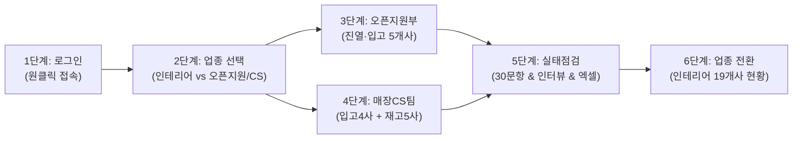
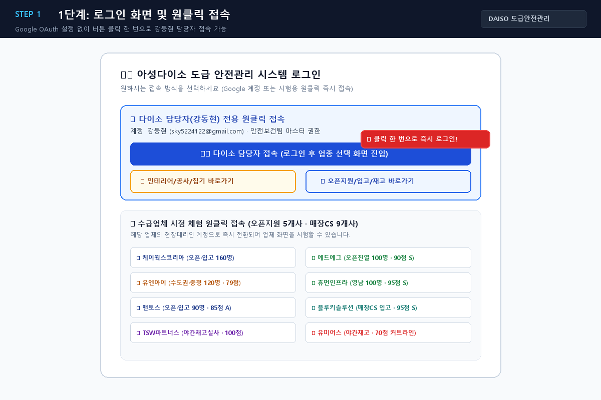
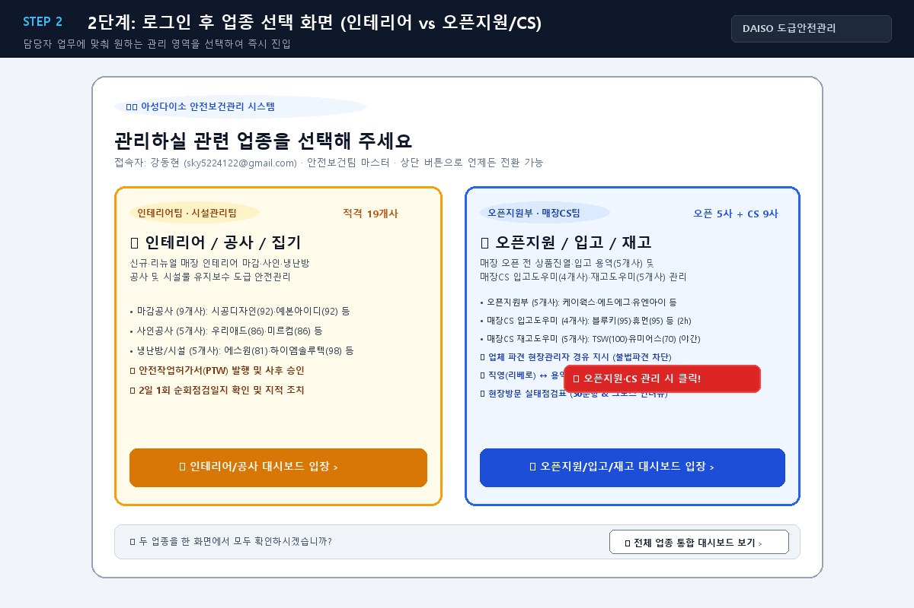
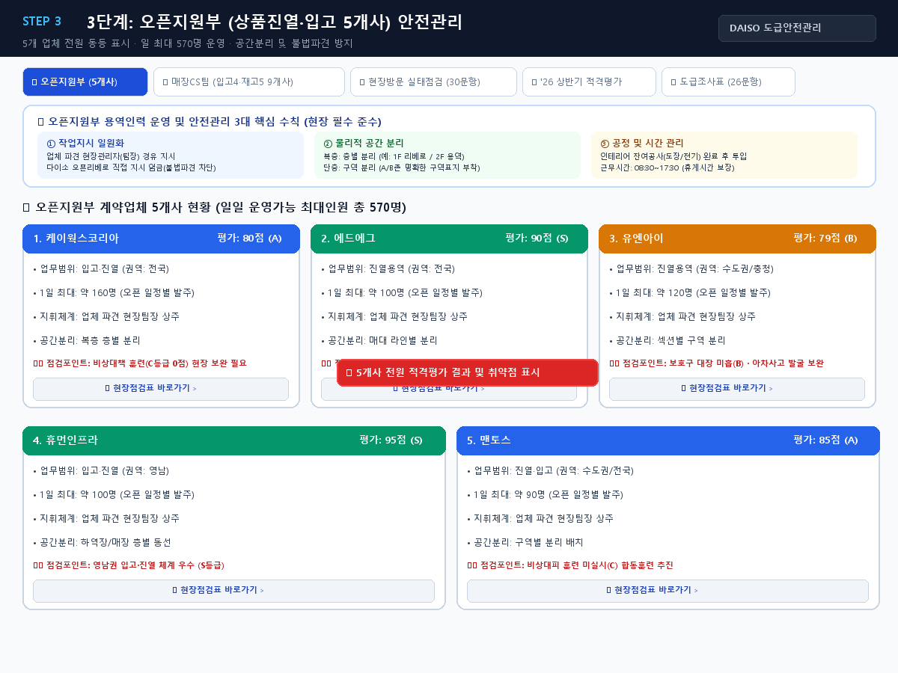
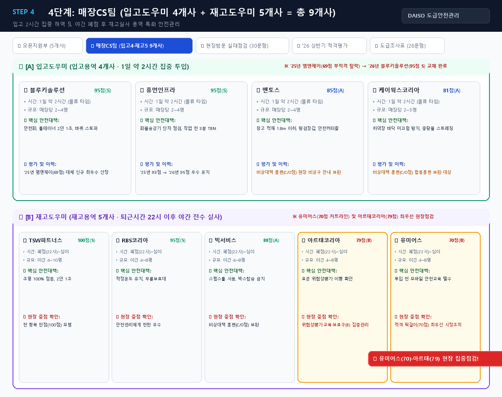
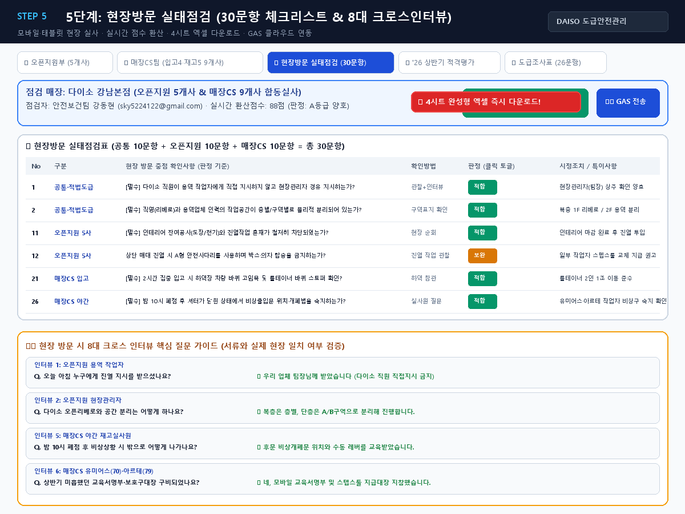
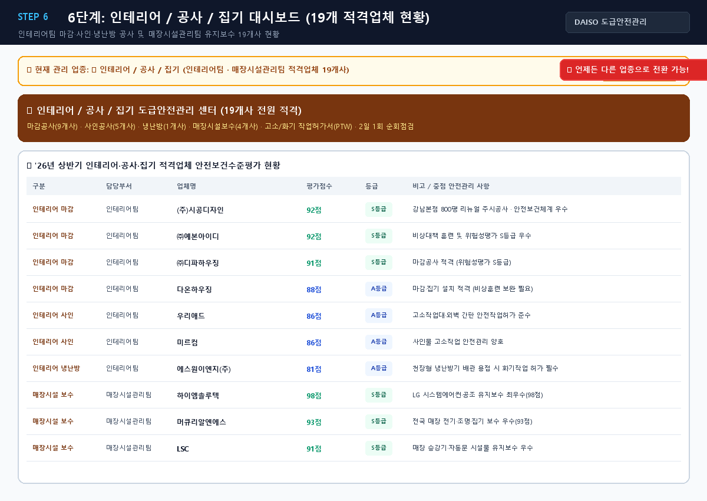

# 📱 아성다이소 도급 안전관리 앱 시각적 사용자 매뉴얼 (Visual User Guide)

> **안내**: 비개발자 담당자(안전보건팀 강동현 과장님)께서 그림만 보고도 바로 사용하실 수 있도록 실제 앱 화면 캡처 이미지와 함께 정리한 설명서입니다.  
> 브라우저로 편하게 보시려면 같은 폴더의 `App_Visual_User_Guide(도급안전관리_앱_시각_사용설명서).html`을 더블클릭하시면 웹 브라우저에서 바로 열립니다.

---

## 📌 한눈에 보는 6단계 이용 흐름 요약

---

## 🖼️ 단계별 상세 사용법 및 화면 안내

### [1단계] 로그인 화면 및 원클릭 즉시 접속
- **화면 설명**: 앱에 처음 접속했을 때 나타나는 화면입니다. Google OAuth 로그인 설정이 없어도 원클릭으로 바로 접속할 수 있습니다.
- **실행 방법**: 파란색 큰 버튼인 **「👨‍💼 다이소 담당자 접속 (강동현)」**을 누르면 관리자 권한으로 즉시 접속됩니다.
- **수급업체 체험**: 하단에 오픈지원 5개사, 매장CS 입고/재고업체, 시공디자인 등 8개 업체의 시점으로 체험할 수 있는 버튼도 함께 제공됩니다.

---

### [2단계] 로그인 직후 관련 업종 선택 화면
- **화면 설명**: 담당자가 접속하면 화면 중앙에 팝업으로 나타나며, 오늘 관리할 업무 영역을 고릅니다.
- **선택 구분**:
  1. **`🏗 인테리어 / 공사 / 집기`**: 인테리어팀(마감 9사·사인 5사·냉난방 1사) 및 매장시설관리팀(시설보수 4사) 총 19개 적격업체 공사 관리
  2. **`📦 오픈지원 / 입고 / 재고`**: 오픈지원부(진열·입고 5개사) 및 매장CS팀(입고도우미 4개사·재고도우미 5개사) 총 14개 계약 건 관리
- **실행 방법**: 오픈지원이나 CS팀 관리 시 우측의 **「📦 오픈지원 / 입고 / 재고 대시보드 입장」** 버튼을 클릭합니다.

---

### [3단계] 오픈지원부 (상품진열·입고 5개사) 안전관리
- **화면 설명**: 오픈지원부 계약업체 5개사 전원(`케이웍스코리아`, `에드에그`, `유엔아이`, `휴먼인프라`, `맨토스`)이 표시되는 화면입니다.
- **핵심 수칙 3가지**:
  1. **작업지시 일원화**: 다이소 직원이 용역 작업자에게 직접 지시 금지 → 반드시 업체 파견 관리자(팀장) 경유 (불법파견 리스크 원천 차단)
  2. **물리적 공간 분리**: 복층 매장은 층별(1F/2F) 분리, 단층 매장은 A/B구역 분리 표지 부착
  3. **혼재작업 차단**: 인테리어 잔여공사(전기/도장) 종료 여부 확인 후 진열 투입
- **업체별 카드**: '26년 상반기 적격평가 점수(S/A/B등급), 1일 최대 투입인원(총 570명), 현장 취약 보완사항이 정리되어 있습니다.

---

### [4단계] 매장CS팀 (입고도우미 4개사 + 재고도우미 5개사 = 총 9개사)
- **화면 설명**: 매장CS팀에서 관리하는 두 가지 특화 용역 업체를 구분하여 표시합니다.
- **세부 구성**:
  - **🚚 [A] 입고도우미 (4개사)**: 하루 약 2시간 집중 투입 (물류 하차 및 창고 적재).  
    *이력: '25년 평가에서 69점(70점 미달 부적격)으로 탈락한 `엠앤제이` 대신 '26년 상반기 `블루키솔루션(95점 S)`으로 교체 완료*
  - **🌙 [B] 재고도우미 (5개사)**: 매장 퇴근시간(22시 폐점) 이후 야간 전수 실사.  
    *집중점검 대상: 적격 턱걸이(70점)인 `유미어스` 및 79점인 `아르테코리아`의 위험성평가·교육서명부·비상대책 현장 확인 필수*

---

### [5단계] 현장방문 실태점검표 (30문항 & 8대 크로스 인터뷰 & 엑셀 다운로드)
- **화면 설명**: 안전보건팀이 매장 현장에 방문했을 때 점검하는 전용 체크리스트 화면입니다.
- **주요 기능**:
  1. **30문항 체크리스트**: 공통 10문항 + 오픈지원 10문항 + 매장CS 10문항을 터치 한 번으로 `[적합 / 보완 / 부적합]` 판정
  2. **실시간 점수 환산**: 상단 배너에 즉시 환산 점수(예: 88점 / 판정: A등급)가 실시간 자동 계산
  3. **8대 크로스 인터뷰**: 작업자, 현장팀장, 점장에게 물어볼 핵심 질문과 안전/위반 답변 가이드
  4. **4시트 엑셀 다운로드**: 상단 초록색 **「📊 현장점검 엑셀(4시트) 다운로드」** 버튼 클릭 시 완성된 엑셀 파일 즉시 다운로드!
  5. **구글 앱스 스크립트(GAS) 전송**: 점검 결과를 본사 구글 시트 클라우드로 원클릭 전송

---

### [6단계] 상단 [업종선택] 버튼으로 인테리어/공사/집기 19개사 대시보드 전환
- **화면 설명**: 오픈지원이나 CS 업무 중 언제든지 화면 오른쪽 위 헤더의 **[🔄 업종선택]** 버튼을 누르면 인테리어/공사/집기 19개 적격업체 대시보드로 즉시 전환할 수 있습니다.
- **19개사 현황**: 인테리어 마감공사(9개사), 사인공사(5개사), 냉난방기(1개사), 매장시설유지보수(4개사)의 평가 점수와 등급, 작업허가서(PTW), 순회점검 현황이 한눈에 표시됩니다.

---

## 📁 관련 파일 바로가기 (클릭하여 열기)

- [App_Visual_User_Guide(도급안전관리_앱_시각_사용설명서).html](file:///D:/■%20AI%20활용%20안전전보건%20자료/13.%20도급%20안전관리%20앱/App_Visual_User_Guide(도급안전관리_앱_시각_사용설명서).html)
- [Field_Inspection_Checklist(오픈지원부_매장CS팀_도급현장_실태점검표_및_분석자료).xlsx](file:///D:/■%20AI%20활용%20안전전보건%20자료/13.%20도급%20안전관리%20앱/Field_Inspection_Checklist(오픈지원부_매장CS팀_도급현장_실태점검표_및_분석자료).xlsx)
- [Field_Inspection_Guide(오픈지원부_매장CS팀_현장점검_분석_및_가이드).md](file:///D:/■%20AI%20활용%20안전전보건%20자료/13.%20도급%20안전관리%20앱/Field_Inspection_Guide(오픈지원부_매장CS팀_현장점검_분석_및_가이드).md)
- [index.html (실제 앱 메인)](file:///D:/■%20AI%20활용%20안전전보건%20자료/13.%20도급%20안전관리%20앱/index.html)
